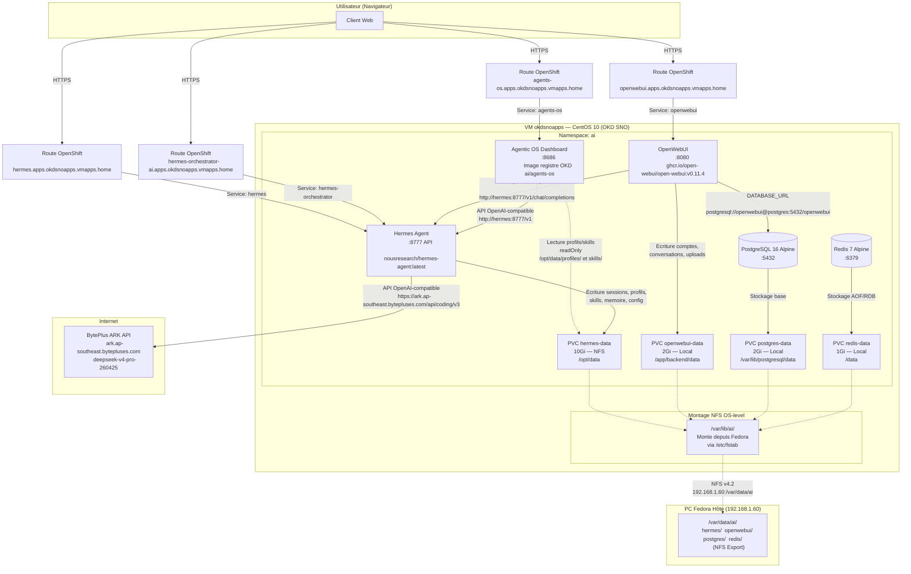

# Architecture et flux de communication — Hermes Agent + Agentic OS

Cluster : `okdsnoapps.vmapps.home` (OKD 4.22 SNO) | Namespace : `ai`
Date : 2026-10-10

---

## 1. Schéma d'architecture



---

## 2. Composants détaillés

### 2.1 OpenWebUI

| Propriété | Valeur |
|---|---|
| Image | `ghcr.io/open-webui/open-webui:v0.11.4` |
| Port | 8080 |
| Route | `https://openwebui.apps.okdsnoapps.vmapps.home` |
| Base de données | PostgreSQL (`DATABASE_URL`) |
| Backend LLM | Hermes Agent (`http://hermes:8777/v1`) |
| Stockage | PVC `openwebui-data` (2Gi, local) → `/app/backend/data` |
| Modèle par défaut | `hermes-agent` |

**Flux :** Navigateur → Route → OpenWebUI → Hermes API → BytePlus

### 2.2 Hermes Agent

| Propriété | Valeur |
|---|---|
| Image | `nousresearch/hermes-agent:latest` |
| Port API | 8777 |
| Mode | `gateway run` (API OpenAI-compatible) |
| Route | `https://hermes.apps.okdsnoapps.vmapps.home` |
| Fournisseur LLM | BytePlus ARK (OpenAI-compatible) |
| Clé API | `BYTEDANCE_API_KEY` (dans Secret `ai-secrets`) |
| Modèle par défaut | `deepseek-v4-pro-260425` |
| Stockage | PVC `hermes-data` (10Gi, NFS) → `/opt/data` |
| Profils créés | architect, senior-dev, code-reviewer, qa-engineer, devops, orchestrator |

**Fichier de configuration :**
- `/opt/data/config.yaml` — provider, modèle, API server, mémoire, skills
- `/opt/data/.env` — clés API (lu par Hermes au démarrage)
- `/opt/data/profiles/*/SOUL.md` — personnalité de chaque profil
- `/opt/data/profiles/*/config.yaml` — configuration par profil

**Flux :** Hermes reçoit une requête OpenAI-compatible → appelle BytePlus → retourne la réponse

### 2.3 Agentic OS Dashboard

| Propriété | Valeur |
|---|---|
| Image | Registre OKD `ai/agents-os` (build local) |
| Port | 8686 |
| Route | `https://agents-os.apps.okdsnoapps.vmapps.home` |
| Authentification | Login/Signup, cookies HttpOnly, SHA-256 |
| Base de données | SQLite (`/data/agentic_os.db`) |
| Backend LLM | Hermes API (`http://hermes:8777/v1`) |
| ServiceAccount | `agents-os` (SCC `anyuid`, UID 10000) |
| RBAC | `agents-os-exec` (pods/exec, pods/get, deployments/get) |
| kubectl | Installe dans l'image pour exec dans le pod Hermes |

**Panneaux :**

| Panneau | Fonction |
|---|---|
| Dashboard | Cartes agents avec chat rapide |
| Canvas | Terminaux simultanés de tous les agents |
| Graphe | Visualisation des tâches par agent |
| Chat | Chat dédié avec sélection d'agent |
| Mémoire | Consultation des mémoires persistantes |
| Skills | Liste des compétences disponibles |
| Kanban | Gestion de missions (todo/progress/done) |
| Administration | Gestion utilisateurs + permissions par panneaux/agents + creation/suppression agents (max 50) |

### 2.4 PostgreSQL

| Propriété | Valeur |
|---|---|
| Image | `postgres:16-alpine` |
| Port | 5432 |
| Base | `openwebui` |
| Utilisateur | `openwebui` |
| Stockage | PVC `postgres-data` (2Gi, local) → `/var/lib/postgresql/data` |
| Utilisé par | OpenWebUI (comptes, conversations, fichiers) |

### 2.5 Redis

| Propriété | Valeur |
|---|---|
| Image | `redis:7-alpine` |
| Port | 6379 |
| Mode | Append-only file (AOF) |
| Stockage | PVC `redis-data` (1Gi, local) → `/data` |
| Utilisé par | OpenWebUI (cache, sessions) |

---

## 3. Flux de communication

### 3.1 Flux utilisateur → OpenWebUI → Hermes → BytePlus

```
Navigateur
    │
    ▼  HTTPS (TLS edge)
Route openwebui.apps.okdsnoapps.vmapps.home
    │
    ▼  HTTP (interne cluster)
OpenWebUI (:8080)
    │
    ▼  HTTP POST /v1/chat/completions
    │  Authorization: Bearer <WEBUI_SECRET_KEY>
    │  Body: {"model": "hermes-agent", "messages": [...]}
    ▼
Hermes Agent (:8777)
    │
    ▼  HTTP POST /v1/chat/completions
    │  Authorization: Bearer <BYTEDANCE_API_KEY>
    │  Body: {"model": "deepseek-v4-pro-260425", "messages": [...]}
    ▼
BytePlus ARK (ark.ap-southeast.bytepluses.com)
    │
    ▼  Réponse JSON
    │  ← Hermes traite et enrichit la réponse
    ▼
    ← OpenWebUI affiche dans le navigateur
```

### 3.2 Flux utilisateur → Agentic OS → Hermes → BytePlus

```
Navigateur
    │
    ▼  HTTPS + Cookie (token)
Route agents-os.apps.okdsnoapps.vmapps.home
    │
    ▼  HTTP (interne cluster)
Agentic OS Dashboard (:8686)
    │
    ├── Authentification : POST /api/login → vérifie SQLite → cookie
    │
    ├── Panneaux : GET /api/profiles → lit PVC hermes-data (profils)
    │             GET /api/skills → lit PVC hermes-data (skills)
    │             GET /api/status → statistiques
    │
    └── Chat : POST /api/chat → POST /v1/chat/completions → Hermes (:8777) → BytePlus
```

### 3.3 Flux d'authentification

```
POST /api/signup
    │   Body: {name, email, password}
    ▼
Vérification email unique
    │
    ├── 1er utilisateur → rôle = "admin"
    └── Suivants → rôle = "user"
    │
    ▼
Hash SHA-256 du mot de passe
    │
    ▼
Insertion dans SQLite (users + sessions)
    │
    ▼
Retour token → cookie HttpOnly
```

### 3.4 Flux d'administration

```
POST /api/admin/user/create     → Créer un utilisateur
POST /api/admin/user/update     → Modifier rôle/statut
POST /api/admin/user/permissions→ Modifier permissions
POST /api/admin/user/delete     → Supprimer utilisateur
POST /api/admin/agent/create    → Créer un agent IA (max 50, via kubectl exec)
POST /api/admin/agent/delete    → Supprimer un agent IA (confirmation par nom)

GET /api/users                  → Liste utilisateurs + permissions
```

---

## 4. Stockage persistant

### 4.1 Hiérarchie des volumes

```
PC Fedora (192.168.1.60)
└── /var/data/ai/
    ├── hermes/              ───► PVC hermes-data  ───► /opt/data       (Hermes)
    ├── openwebui/           ───► PVC openwebui-data──► /app/backend/data (OpenWebUI)
    ├── postgres/            ───► PVC postgres-data ───► /var/lib/postgresql/data (PostgreSQL)
    └── redis/               ───► PVC redis-data    ───► /data          (Redis)
```

### 4.2 Détail des PVCs

| PVC | Taille | Type | Reclaim | Chemin hôte | Montage conteneur |
|---|---|---|---|---|---|
| `hermes-data` | 10Gi | NFS (Fedora) | Retain | `/var/data/ai/hermes` | `/opt/data` |
| `openwebui-data` | 2Gi | Local (VM) | Retain | `/var/lib/ai/openwebui` | `/app/backend/data` |
| `postgres-data` | 2Gi | Local (VM) | Retain | `/var/lib/ai/postgres` | `/var/lib/postgresql/data` |
| `redis-data` | 1Gi | Local (VM) | Retain | `/var/lib/ai/redis` | `/data` |

### 4.3 Contenu du PVC Hermes

```
/opt/data/
├── config.yaml           ← Configuration Hermes (provider, modèle)
├── .env                  ← Clés API (OPENAI_API_KEY, OPENAI_BASE_URL)
├── SOUL.md               ← Personnalité par défaut
├── profiles/             ← Profils d'agents spécialisés
│   ├── architect/
│   ├── senior-dev/
│   ├── code-reviewer/
│   ├── qa-engineer/
│   ├── devops/
│   └── orchestrator/
├── skills/               ← Skills disponibles
├── sessions/             ← Conversations
├── memory/               ← Mémoire persistante
├── cron/                 ← Tâches planifiées
├── state.db              ← Base d'état SQLite
├── kanban.db             ← Base kanban
├── gateway_state.json    ← État de la passerelle
└── logs/                 ← Journaux
```

---

## 5. Sécurité

### 5.1 Authentification

| Composant | Méthode |
|---|---|
| OpenWebUI | Compte local (email + mot de passe) |
| Agentic OS | Login/Signup avec cookie HttpOnly |
| Hermes API | Token API (WEBUI_SECRET_KEY) |
| BytePlus | Clé API (BYTEDANCE_API_KEY) |

### 5.2 Permissions (Agentic OS)

| Rôle | Accès |
|---|---|
| **Admin** | Tous les panneaux, tous les agents, administration |
| **User** | Panneaux et agents définis dans ses permissions |

Les permissions sont stockées en JSON dans la colonne `permissions` de la table `users` :
```json
{
  "panels": ["overview", "chat", "kanban"],
  "agents": ["architect", "devops"]
}
```

### 5.3 TLS

Toutes les routes OpenShift utilisent TLS **edge** avec redirection HTTP → HTTPS.

---

## 6. URLs

| Service | URL | Type |
|---|---|---|
| OpenWebUI | `https://openwebui.apps.okdsnoapps.vmapps.home` | Interface utilisateur |
| Hermes API | `https://hermes.apps.okdsnoapps.vmapps.home` | API OpenAI-compatible |
| Agentic OS | `https://agents-os.apps.okdsnoapps.vmapps.home` | Dashboard + Auth |
| Orchestrateur | `https://hermes-orchestrator-ai.apps.okdsnoapps.vmapps.home` | API Hermes (alias) |
| Console OKD | `https://console-openshift-console.apps.okdsnoapps.vmapps.home` | Administration cluster |

---

## 7. Dépendances réseau

| Source | Destination | Port | Protocole | Raison |
|---|---|---|---|---|
| Hermes | BytePlus ARK | 443 | HTTPS | Appels LLM |
| OpenWebUI | PostgreSQL | 5432 | TCP | Base de données |
| Agentic OS | Hermes | 8777 | HTTP | API LLM |
| Agentic OS | PVC hermes-data | - | Filesystem | Lecture profils |
| Navigateur | Routes OpenShift | 443 | HTTPS | Interface utilisateur |
| VM okdsnoapps | Fedora (NFS) | 2049 | TCP | Stockage persistant |
