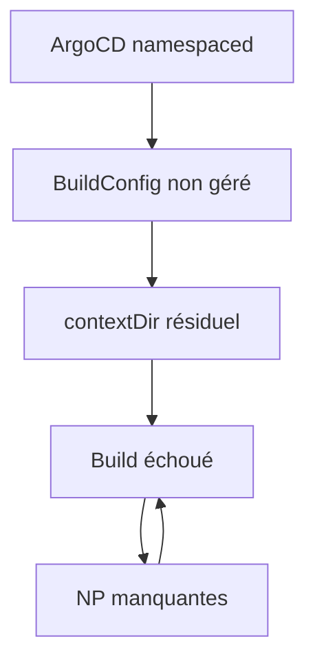

# Anomalies & Solutions — Index

> Index des 11 anomalies rencontrées lors de la migration GitOps du projet `ai`
> sur `okdsnoapps.vmapps.home` vers ArgoCD.
> Date : 2026-10-10

---

## Résumé

| # | Anomalie | Cause | Solution | Impact | Document |
|---|----------|-------|----------|--------|----------|
| 1 | ArgoCD namespaced | Installation par défaut de l'opérateur | Label `managed-by` + RBAC + retrait ressources cluster-level | Bloquant | [Détails](anomalie-01-argocd-namespaced.md) |
| 2 | Token JWT expiré | Session JWT 24h | Re-login avec mot de passe admin | Bloquant | [Détails](anomalie-02-token-jwt-expire.md) |
| 3 | Tag Hermes 0.3.14 inexistant | Tag non vérifié sur Docker Hub | Correction vers `rc.9-v0.21.7-amd64` | Bloquant | [Détails](anomalie-03-tag-hermes-inexistant.md) |
| 4 | Conflit value/valueFrom | Ancien déploiement vs nouveau manifest | Suppression puis recréation du déploiement | Bloquant | [Détails](anomalie-04-conflit-value-valuefrom.md) |
| 5 | BuildConfig Git incompatible | Repo privé sans secret | Maintien en Binary + OutOfSync assumé | Mineur | [Détails](anomalie-05-buildconfig-binary-git.md) |
| 6 | NetworkPolicies bloquent builds | Absence de règles pour les pods de build | 2 nouvelles NP `allow-egress-builds*` | Bloquant | [Détails](anomalie-06-networkpolicies-builds.md) |
| 7 | contextDir résiduel | Héritage du build Git | Suppression du champ | Bloquant | [Détails](anomalie-07-contextdir-residuel.md) |
| 8 | Quoting PowerShell/WSL | Différence de syntaxe entre shells | Scripts fichiers au lieu d'inline | Gênant | [Détails](anomalie-08-quoting-powershell-wsl.md) |
| 9 | Ancienne image agents-os | Code modifié sans rebuild | Nouveau build Binary (#17) | Fonctionnel | [Détails](anomalie-09-agents-os-restructuration.md) |
| 10 | Dashboard : localStorage non protégé | `localStorage.getItem()` sans try/catch plante tout le JS | try/catch autour des accès localStorage | Bloquant | [Détails](anomalie-10-dashboard-localstorage.md) |
| 11 | Déploiement v3 : WORKDIR + CSS manquant | `python -m backend.main` + import `from config` incompatible | WORKDIR + COPY dist/ | Bloquant | [Détails](anomalie-11-deploiement-v3.md) |
| 11 | Déploiement v3 : WORKDIR + CSS manquant | `python -m backend.main` + import `from config` incompatible | WORKDIR + COPY dist/ | Bloquant | [Détails](anomalie-11-deploiement-v3.md) |
| 11 | Déploiement v3 : WORKDIR + CSS manquant | `python -m backend.main` + import `from config` incompatible | WORKDIR + COPY dist/ | Bloquant | [Détails](anomalie-11-deploiement-v3.md) |
| 11 | Déploiement v3 : WORKDIR + CSS manquant | `python -m backend.main` + import `from config` incompatible | WORKDIR + COPY dist/ | Bloquant | [Détails](anomalie-11-deploiement-v3.md) |
| 11 | Déploiement v3 : WORKDIR + CSS manquant | `python -m backend.main` + import `from config` incompatible | WORKDIR + COPY dist/ | Bloquant | [Détails](anomalie-11-deploiement-v3.md) |
| 11 | Déploiement v3 : WORKDIR + CSS manquant | `python -m backend.main` + import `from config` incompatible | WORKDIR + COPY dist/ | Bloquant | [Détails](anomalie-11-deploiement-v3.md) |
| 11 | Déploiement v3 : WORKDIR + CSS manquant | `python -m backend.main` + import `from config` incompatible | WORKDIR + COPY dist/ | Bloquant | [Détails](anomalie-11-deploiement-v3.md) |
| 11 | Déploiement v3 : WORKDIR + CSS manquant | `python -m backend.main` + import `from config` incompatible | WORKDIR + COPY dist/ | Bloquant | [Détails](anomalie-11-deploiement-v3.md) |
| 11 | Déploiement v3 : WORKDIR + CSS manquant | `python -m backend.main` + import `from config` incompatible | WORKDIR + COPY dist/ | Bloquant | [Détails](anomalie-11-deploiement-v3.md) |
| 11 | Déploiement v3 : WORKDIR + CSS manquant | `python -m backend.main` + import `from config` incompatible | WORKDIR + COPY dist/ | Bloquant | [Détails](anomalie-11-deploiement-v3.md) |
| 11 | Déploiement v3 : WORKDIR + CSS manquant | `python -m backend.main` + import `from config` incompatible | WORKDIR + COPY dist/ | Bloquant | [Détails](anomalie-11-deploiement-v3.md) |

---

## Catégories

### 🔴 Infrastructures
- [Anomalie 1 — ArgoCD namespaced](anomalie-01-argocd-namespaced.md)
- [Anomalie 6 — NetworkPolicies builds](anomalie-06-networkpolicies-builds.md)

### 🔴 Déploiement
- [Anomalie 3 — Tag Hermes inexistant](anomalie-03-tag-hermes-inexistant.md)
- [Anomalie 4 — Conflit value/valueFrom](anomalie-04-conflit-value-valuefrom.md)
- [Anomalie 5 — BuildConfig Git incompatible](anomalie-05-buildconfig-binary-git.md)
- [Anomalie 7 — contextDir résiduel](anomalie-07-contextdir-residuel.md)

### 🟡 Maintenance
- [Anomalie 2 — Token JWT expiré](anomalie-02-token-jwt-expire.md)
- [Anomalie 9 — Agents OS restructuration](anomalie-09-agents-os-restructuration.md)

### 🟢 Outils
- [Anomalie 8 — Quoting PowerShell/WSL](anomalie-08-quoting-powershell-wsl.md)

---

## Connexions entre anomalies

---

## Statistiques

- **Total anomalies** : 11
- **Bloquantes** : 8
- **Mineures** : 1
- **Gênantes** : 1
- **Fonctionnelles** : 1 (résolue après rebuild)
